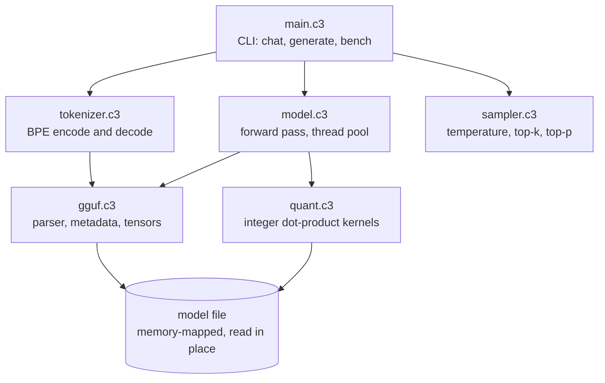

# c3llm

A GGUF inference engine written from scratch in [C3](https://c3-lang.org), using only the C3 standard library. It runs Llama 3.2 on the CPU at close to the speed of `llama.cpp`.

```text
> c3llm chat models\Llama-3.2-1B-Instruct-Q4_0.gguf
Type a message and press Enter. An empty line exits.

> hello
Hello! How can I help you today?

[prompt: 11 tokens, 11.6 tok/s | generation: 9 tokens, 9.8 tok/s]
```

It was built for fun, to see how far an uncommon language could be pushed on a real workload. It is about 1,500 lines of C3.

## Speed

Llama 3.2 1B Instruct (Q4_0, 773 MB) on a Ryzen 5 5500U laptop (6 cores, AVX2), 200-token replies, greedy sampling:

| Engine | Generation |
|---|---|
| c3llm | 35 to 36 tokens per second |
| llama.cpp (build b12322, CPU) | 37 to 38 tokens per second |

Generation is limited by how fast the machine can read the weights from memory, which is why the two land so close. Prompt reading is about 4 times slower than `llama.cpp`, because c3llm processes prompt tokens one at a time.

[docs/OPTIMIZATIONS.md](docs/OPTIMIZATIONS.md) records how it got from 1 token per second to 36, including what did not work.

## What it supports

- **Models:** the Llama 3 family (`general.architecture = llama`, GPT-2 style BPE tokenizer). Tested with Llama 3.2 1B Instruct only.
- **Tensor types:** F32, Q4_0, Q4_1 and Q6_K. That covers files labelled Q4_0, which in practice also contain a few Q4_1 and Q6_K tensors. Run `c3llm inspect` on a file to see what it uses.
- **Sampling:** greedy, temperature, top-k and top-p.
- **Platform:** Windows x64 with AVX2 and FMA. Nothing in the engine is Windows-specific, but the build script is, and other platforms are untested.

Not supported: other architectures (Qwen, Mistral, Gemma), other quantizations (Q4_K_M, Q5, Q8), GPUs, and chat templates other than Llama 3's.

## Build

You need:

- **[c3c](https://github.com/c3lang/c3c/releases) 0.8.6**, on your `PATH` or unpacked into `tools\c3`.
- **[MSYS2](https://www.msys2.org) with the UCRT64 gcc** at `C:\msys64\ucrt64`. It is used only as the linker, which avoids the Microsoft SDK that c3c would otherwise download.

Then:

```text
.\build.ps1          # safe build, with bounds checks and asserts
.\build.ps1 -O3      # fast build
```

Both produce `build\c3llm.exe`. The script targets AVX2 and FMA explicitly, because `--x86cpu=native` selected only AVX1 on the CPU this was developed on.

## Get a model

Download a Q4_0 GGUF of Llama 3.2 Instruct into `models\`, for example `Llama-3.2-1B-Instruct-Q4_0.gguf` from [bartowski/Llama-3.2-1B-Instruct-GGUF](https://huggingface.co/bartowski/Llama-3.2-1B-Instruct-GGUF). The model is covered by Meta's Llama 3.2 license, not this repository's.

## Use

```text
c3llm chat <model.gguf> [temperature]
c3llm generate <model.gguf> <new tokens> <prompt> [threads]
c3llm tokenize <model.gguf> <text>
c3llm inspect <model.gguf>
c3llm bench <model.gguf> [threads]
c3llm selftest
```

- **`chat`** is an interactive conversation in the Llama 3 turn format. Temperature defaults to 0.8; top-k is 40 and top-p is 0.95.
- **`generate`** continues a raw prompt with greedy sampling. Special tokens such as `<|eot_id|>` can be written inline.
- **`tokenize`** prints the token ids for a piece of text.
- **`inspect`** prints a file's metadata and every tensor's name, type, shape and offset.
- **`bench`** times forward passes and shows where each token's time goes.
- **`selftest`** checks the parser, the kernels, the tokenizer and the sampler against known answers.

## How it works



The model file is memory-mapped and never copied. Each token runs through 16 transformer layers; nearly all of the time goes into about 113 matrix-vector products, which are computed as integer multiply-adds over the quantized weights and spread across threads.

[docs/ARCHITECTURE.md](docs/ARCHITECTURE.md) explains each part.

## Compare with llama.cpp

`compare\` holds a small page that sends one message to both engines and shows the two replies, their speed, and where the text first differs.

1. Unpack a [llama.cpp release](https://github.com/ggml-org/llama.cpp/releases) for Windows into `tools\llama.cpp`.
2. Put the model at `models\Llama-3.2-1B-Instruct-Q4_0.gguf`.
3. Run `node compare\server.js` and open http://127.0.0.1:8790.

It needs Node.js 18 or later and loads React from a CDN.

## Accuracy

The self-test checks every kernel against a plain floating-point reference. The tokenizer produces the same ids as `llama-tokenize` on the ASCII strings tested.

Against `llama.cpp` with greedy sampling, replies start out identical and usually drift into different wording after a few hundred characters. The two engines round intermediate values differently, and greedy sampling turns any difference at a near-tie into a different word. Both stay coherent.

Known gaps:

- **Non-ASCII tokenization.** The pre-tokenizer treats every non-ASCII byte as a letter, so emoji and non-ASCII punctuation, digits and spaces can split differently from `llama.cpp`.
- **Context.** The context is capped at 4,096 tokens, and a chat stops when it is full.
- **Chat template.** The Llama 3 format is hardcoded; the template stored in the model file is not interpreted.

## License

[MIT](LICENSE).

The GGUF format and the quantization layouts come from [llama.cpp](https://github.com/ggml-org/llama.cpp), which was also the reference for checking results.
