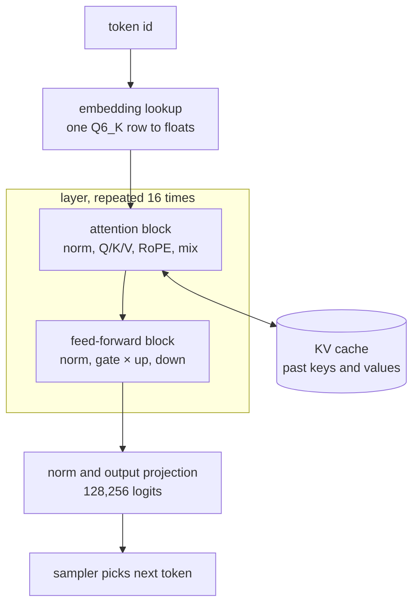
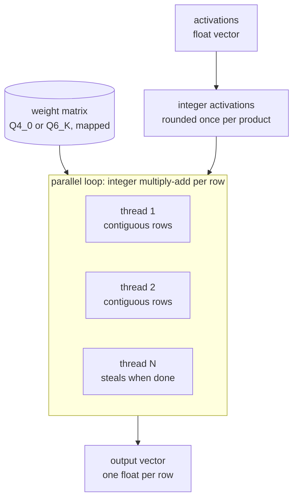

# Architecture

How c3llm turns a prompt into text, file by file.

## Overview

| File | What it does |
|---|---|
| `src/main.c3` | Command-line interface, the chat loop, the bench, and the self-test. |
| `src/gguf.c3` | Memory-maps a GGUF file and parses its header, metadata and tensor directory. |
| `src/tokenizer.c3` | Byte-level BPE: text to token ids and back. |
| `src/model.c3` | Loads and checks the weights, holds the run state, runs the forward pass, and owns the thread pool. |
| `src/quant.c3` | Quantized formats: dequantization, and the integer dot-product kernels. |
| `src/sampler.c3` | Picks the next token from the logits. |

Generating one reply:

1. `gguf::open` maps the file.
2. `tokenizer::load` builds the vocabulary and merge tables from the file's metadata.
3. `model::load` finds each tensor, checks its shape and bounds, and allocates the run state.
4. The prompt is tokenized and each token is fed through `Model.forward`.
5. The sampler picks a token from the logits, it is decoded and printed, and it is fed back in.

## The GGUF parser

A GGUF file is a header, a list of metadata key-value pairs, a tensor directory, and then the tensor data.

- **No copies.** The file is memory-mapped once. Strings, arrays and tensors are views into the mapping. The 128,256-entry vocabulary, for example, is never expanded until the tokenizer walks it.
- **Bounds-checked reads.** Every read goes through a `Reader` that returns a fault at the end of the data, so a truncated or corrupt file gives an error and not a crash.
- **Tensor data** starts at the next multiple of `general.alignment` (default 32) after the directory. Each tensor's offset is checked to lie inside the file.

Hyperparameters are read from keys prefixed with the value of `general.architecture`, such as `llama.block_count`.

## The tokenizer

Llama 3 uses GPT-2 style byte-level BPE.

1. **Special tokens** written as `<|name|>` are matched first and map straight to their ids. Text typed in the chat loop skips this step, so a user cannot inject a control token.
2. **Pre-tokenization** splits the text into words with a hand-written matcher for the `llama-bpe` pattern: contractions, letter runs with an optional leading space, digit groups of up to three, punctuation runs, and whitespace.
3. **Byte mapping.** Each byte of a word becomes one printable character, the way GPT-2 writes them (a space becomes `Ġ`).
4. **Merging.** The adjacent pair with the lowest rank in `tokenizer.ggml.merges` is merged, repeatedly, until no pair has a rank.
5. **Lookup.** Each remaining symbol is looked up in the vocabulary.

Decoding reverses the byte mapping and emits raw bytes, so a character split across two tokens still prints correctly.

## The forward pass



For each token, `Model.forward` does the following.

**Embedding.** One row of `token_embd.weight` is dequantized into the hidden state `x`.

**Attention block**, per layer:

1. RMSNorm of `x`.
2. Three matrix products give the query, key and value vectors. Llama 3.2 1B has 32 query heads sharing 8 key/value heads.
3. Rotary position embedding rotates pairs of query and key dimensions by an angle that depends on the token's position. Llama 3 stores per-frequency scaling factors in `rope_freqs.weight`, and the angle is divided by them.
4. The key and value are written to the KV cache at this position.
5. Each head scores every cached key against its query, applies softmax, and mixes the cached values.
6. One more matrix product, and the result is added to `x`.

**Feed-forward block**, per layer:

1. RMSNorm of `x`.
2. Two matrix products, `gate` and `up`.
3. `silu(gate) * up`.
4. A matrix product `down`, and the result is added to `x`.

**Output.** After a final RMSNorm, the hidden state is multiplied by the embedding table again to produce one logit per vocabulary entry. Llama 3.2 ties these weights, so there is no separate output tensor. This step is skipped for prompt tokens other than the last.

The run state is allocated once at load. The KV cache is capped at 4,096 positions; the model declares 131,072, which would need about 8.6 GB.

## Quantized kernels

Almost all of a token's time goes into matrix-vector products over quantized weights.

### Formats

| Format | Block | Layout | Weight value |
|---|---|---|---|
| Q4_0 | 32 weights, 18 bytes | half-float `d`, 16 bytes of nibbles | `d * (nibble - 8)` |
| Q4_1 | 32 weights, 20 bytes | half-floats `d` and `m`, 16 bytes of nibbles | `d * nibble + m` |
| Q6_K | 256 weights, 210 bytes | 128 bytes of low bits, 64 of high bits, 16 int8 scales, half-float `d` | `d * scale * (value - 32)` |

### One matrix product



**Activations become integers.** Before the rows are processed, the activation vector is rounded to 16-bit integers, block by block, with one float scale per block chosen so the block's largest value maps to the top of the range. This happens once per product and is shared by every row.

**Rows are integer multiply-adds.** The inner step is the AVX2 instruction `vpmaddwd`: multiply 16 pairs of 16-bit values and add neighbours. C3 has no way to call it by name, so it is written as plain vector code in a shape LLVM recognises:

```c3
macro int[<8>] madd(short[<16>] a, short[<16>] b)
{
	int[<16>] m = (int[<16>])a * (int[<16>])b;
	return swizzle(m, 0, 2, 4, 6, 8, 10, 12, 14) + swizzle(m, 1, 3, 5, 7, 9, 11, 13, 15);
}
```

**Offsets are handled once.** The `- 8` in Q4_0 and the `- 32` in Q6_K are not applied to each weight. The kernels multiply the stored unsigned values, and subtract a correction computed from the activation totals when the activations were rounded.

**Block scales come from a table.** Each block's half-float scale is converted with a 65,536-entry lookup table, which is much faster than the CPU's conversion instruction when done one value at a time.

**Integer ranges.** The rounding limits (15 bits for the 4-bit formats, 10 for Q6_K) are chosen so no sum in a kernel can exceed 32 bits.

## The thread pool

`model::parallel(job, ctx, count, chunk)` runs a function over a range on all threads and returns when it is done. Matrix rows, attention heads and the SiLU step all use it.

- **Contiguous shares.** The range is split into one contiguous share per thread. Each core therefore reads the weights as one steady stream, which is what the hardware prefetcher handles best.
- **Stealing.** A thread that finishes its share claims chunks from the others.
- **Spinning.** Parallel loops arrive microseconds apart, faster than a sleeping thread can wake, so idle workers spin and only sleep after about a millisecond with nothing to do.
- **Yielding.** A spinning thread gives up its CPU every 256 iterations. Without that, a worker the OS had descheduled in the middle of a chunk could be starved by the threads waiting for it.

The default thread count is all logical CPUs but two.

## Sampling

With temperature 0 the sampler returns the most likely token. Otherwise it keeps the `top_k` largest logits in a small sorted array, applies temperature and softmax, cuts the list at cumulative probability `top_p`, and draws from what is left with a xorshift generator.

## Testing

`c3llm selftest` builds its inputs in memory and needs no model file. It covers:

- **Parser:** a hand-built GGUF, plus truncated and bad-magic variants.
- **Kernels:** each integer kernel against the dequantize-then-multiply reference, on inputs that survive rounding exactly.
- **Tokenizer:** the byte mapping for all 256 bytes, the pre-tokenizer split on a mixed string, and merges on a toy vocabulary.
- **Sampler:** that temperature 0, top-k 1 and a tiny top-p all reduce to the most likely token.

Run it with the safe build (`.\build.ps1` with no flags), which keeps bounds checks and asserts on.
